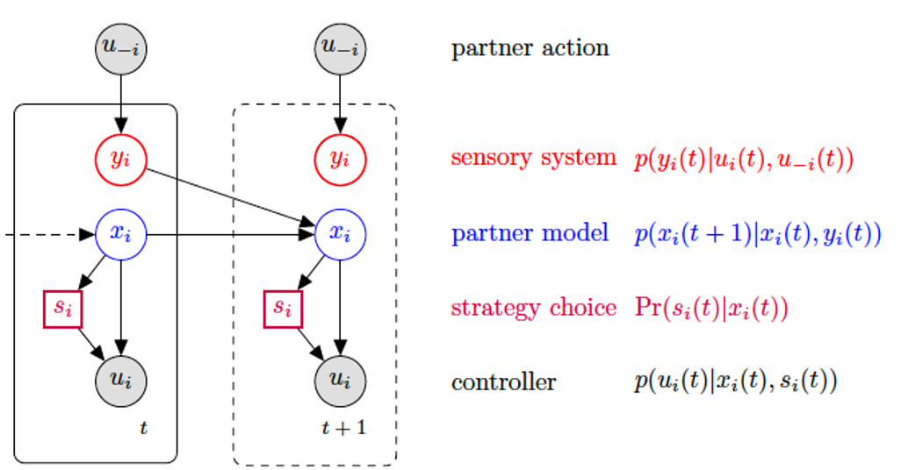

# Computational Joint Action model
This repository contains the source code for the computational model of joint action described in paper [De Vicariis C, Chackochan VT, Bandini L, Ravaschio E, Sanguineti V (2024) Computational joint action: Dynamical models to understand the development of joint coordination. PLoS Comput Biol 20(10): e1011948](https://doi.org/10.1371/journal.pcbi.1011948).

The model is summarized below.

Each agent has a sensory system, an observer and a controller. The actions are assumed to be continuous variables (possibly vectors).

- The **sensory system** perceives the partner action. We assume that the sensory information is just the partner's action plus a Gaussian noise.
- The **observer** combines prior experience and sensory information to predict the partner's action on the next game iteration (trial). The observer is a Kalman filter which combines a prior (partner model) and the sensory information.
- The **controller** generates the agent's action on the basis of the prediction of the partner model. Each agent's action is specified by a set of quadratic cost functions (of own and partner actions). One categorical variable (*strategy choice*) determines which cost function is used to generate the actual action. If the cost function is positive definite, the action has a Gaussian mixture distribution (one Gaussian per strategy). This formulation generalizes the notion of quadratic game and allows for multiple Nash equilibria and mixed strategies. 

The model can be used:
- To simulate joint action scenarios involving iterated game plays. Actions can be described by scalars or vectors. Movement trajectories can be represented as harmonic splines in terms of vectors of nodes. 
- To analyse joint action time series, by calculating the model parameters that best reproduce the experimental data. 

Directory ./Data_Paper contains the data used in the paper. 

Directory ./data contains other test data to be used for model-based analysis

Directory ./src contains the classes that specify the general model, which can be used for both simulating a joint action scenario or to analyze joint action time series.

